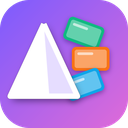
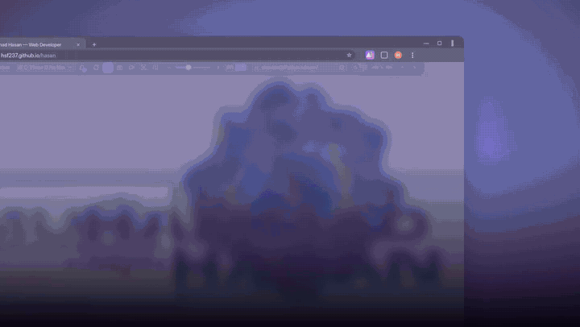

# Prism — Multi-Device Preview

**See any website on 34 real devices, side by side, at true size. One click. Free.**

[**▶ Watch the full 53-second demo**](promo/Prism-Ad.mp4) · [**⬇ Download**](https://github.com/HSF237/PRISM/releases/latest) · [**Report a bug**](https://github.com/HSF237/PRISM/issues)

## Why Prism?

Resizing your browser window doesn't show you what your site really looks like on a phone. Prism opens your page on up to 4 live devices at once, right on top of the tab you're on:

- 📱 **34 real devices**: iPhones, Pixels, Galaxys, iPads, Surface, MacBooks and monitors
- 📏 **True-to-life sizes**: each device is drawn to its real dimensions, so a phone looks phone-sized next to a laptop
- 📖 **Foldables that actually fold**: iPhone Duo, Galaxy Z Fold 6 and Pixel 9 Pro Fold open with a 3D animation
- 🔁 **Synced scroll and navigation**: scroll or click on one device and they all follow
- 📸 **Screen-only screenshots** and screen recording
- 🎨 **Themes, backdrops and device finishes**
- 🔒 **No data collected**: nothing ever leaves your browser

## Install

1. Download **`prism.zip`** from the [latest release](https://github.com/HSF237/PRISM/releases/latest) (or click **Code → Download ZIP** above) and unzip it.
2. Open `chrome://extensions` and turn on **Developer mode** (top right).
3. Click **Load unpacked** and pick the unzipped folder (the one with `manifest.json` in it).
4. Pin Prism, open any website and click the icon (or press **Alt+Shift+M**).

Chrome Web Store listing coming soon.

## All features

- **Live device frames**: iPhone 17 Pro Max / Air / 17 Pro / 17 / 17e / Duo / 16 Pro Max / 16e / 15 / SE, Pixel 9 Pro / 9 / 8 / 9 Pro Fold, Galaxy S25 Ultra / S25 / S24 Ultra / S24 / A55 / Z Fold 6 / Z Flip 6, OnePlus 12, iPads, Galaxy Tab S10+/S9, Surface, MacBook Air/Pro, 1080p/1440p monitors, plus any custom size.
- **iPhone Duo**: drawn to Apple's real proportions (164.6 × 117.8 mm open). Closed, it's shown like Apple's product shot: the back with the camera pill and logo, next to the live 5.4" cover display (466 × 678). Press **G** and it turns over to the 7.6" inner display (890 × 626). It comes in Star White, or Night Sky with the Deep Blue finish. The CSS sizes assume iPhone's usual 3× scale, because Apple only publishes pixel resolutions.
- **Foldables**: Galaxy Z Fold 6 and Pixel 9 Pro Fold open like a book, onto one continuous inner screen with a crease and hinge caps.
- **True-to-life sizes**: every device uses its real CSS viewport plus the manufacturer's body size, resolution and pixel density. Prism works out pixels-per-mm from the screen and draws the body to scale, so bezels, chins and proportions match the real device. The Z Fold 6 and Galaxy Tab S10+ viewports are estimated from their pixel density.
- **Motion**: devices glide when the layout changes, rotation physically turns the device, switching device flips it like a card, and devices fly in and out in 3D.
- **Real emulation per device**: mobile user agent, `maxTouchPoints`, touch media queries (`pointer: coarse`, `hover: none`), hidden scrollbars and a touch cursor.
- **Sync scroll**: scroll one device and the others follow (proportionally).
- **Sync navigation**: click a link in one device and every device goes there.
- **Device panel**: up to 4 colour-coded slots, search, portrait/landscape, foldable cover/inner toggle, custom W × H.
- **Screenshots**: `S` = active device with a transparent-cornered frame, `Shift+S` = all devices.
- **Recording**: records the active device as MP4/WebM (Chrome asks you to confirm sharing the tab).
- **Spotlight** mode, **zoom/fit**, a hideable toolbar, and **dark/light** themes.
- **Backdrops**: Glass (blurred page), Clear, Aurora, Studio, Mesh.
- **Frame finishes**: Midnight, Titanium, Silver, Deep Blue, Cosmic Orange.
- **Browser UI** option: Safari pill bar, Chrome Android bar, desktop window chrome.

## Shortcuts

| Key | Action |
| --- | --- |
| R | Rotate active device |
| G | Fold / Unfold active device |
| S / Shift+S | Screenshot active / all |
| Y | Toggle sync scroll |
| F | Spotlight |
| 1–4 | Select device |
| + / − / 0 | Zoom in / out / fit |
| M | Hide toolbar |
| T | Light / dark |
| Esc | Close |

## Notes

- To let sites load inside the device frames, the extension removes `X-Frame-Options` and CSP headers, but only for frames inside that one tab and only while Prism is open there. The rule is removed when you close it.
- The mobile user-agent *header* is only sent when no desktop device is on screen, so it doesn't conflict with the desktop preview. JavaScript-level emulation always runs per device.
- Chrome doesn't allow extensions on `chrome://` pages or the Chrome Web Store. The icon shows a red `!` there.

## Contributing

Ideas, bug reports and pull requests are all welcome. Good first contributions:

- Add a device to [`stage/devices.js`](stage/devices.js) (real CSS viewport, body size in mm, resolution and pixel density)
- Test on Edge, Brave or Opera and report what breaks
- Translate the UI

Open an [issue](https://github.com/HSF237/PRISM/issues) first for bigger changes.

## Credits

Built by [Muhammad Hasan](https://github.com/HSF237) · Zerox Studios.
Promo music ("House Vibes") and sound effects are from [Mixkit](https://mixkit.co), used under the Mixkit free license.

If Prism saves you time, **⭐ star the repo**. It helps other developers find it.

## License

[MIT](LICENSE)
